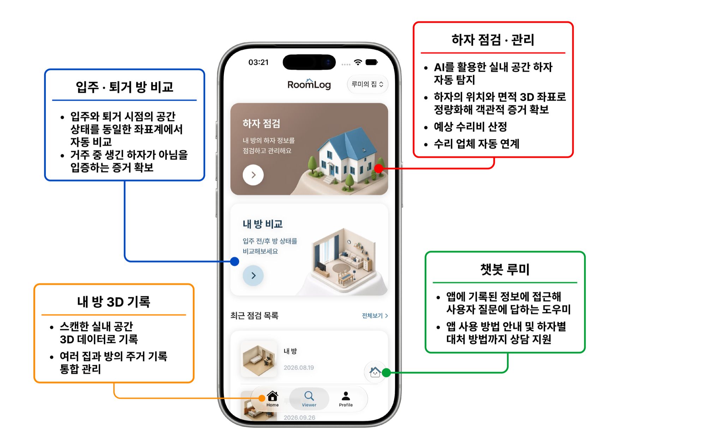
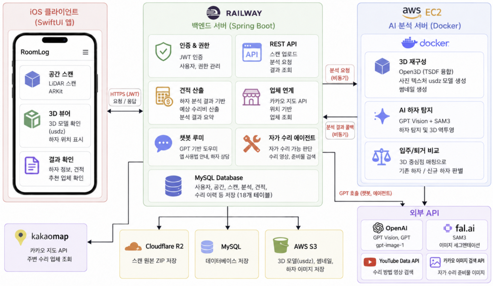
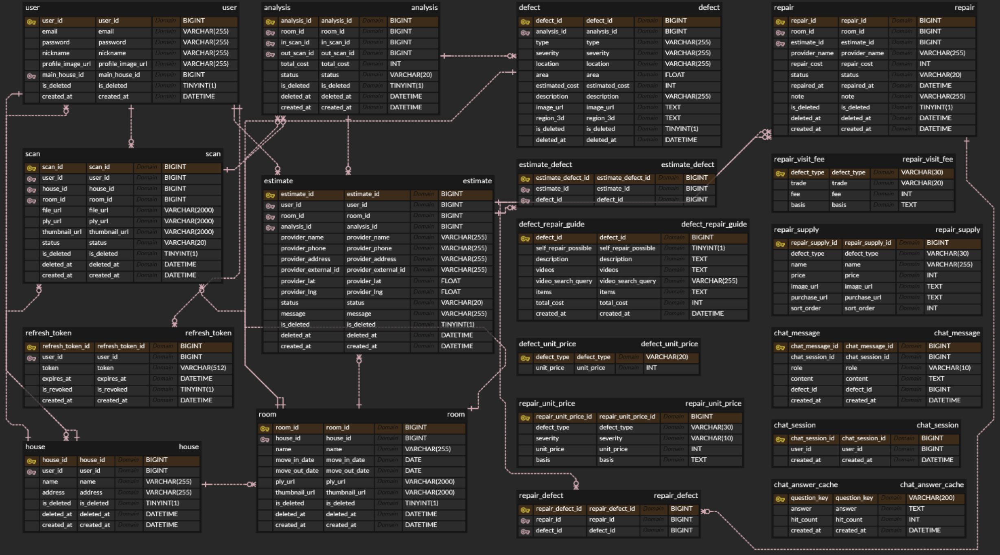

# 📝[	2026년 한이음 드림업 프로젝트 LiDAR 기반 디지털 트윈을 활용한 주거 하자 기록 및 분쟁 대응 시스템]
- 본 프로젝트는 과학기술정보통신부 대학디지털교육역량강화사업의 지원을 통해 수행한 한이음 드림업 프로젝트 26_HC085 팀의 결과물입니다.
---

## **💡1. 프로젝트 개요**

**1-1. 프로젝트 소개**
- 프로젝트 명 : RoomLog: LiDAR 기반 디지털 트윈을 활용한 주거 하자 기록 및 분쟁 대응 시스템
- 프로젝트 정의 : iPhone LiDAR로 주거 공간을 3D로 기록하고, 방 안의 하자를 AI가 자동으로 탐지해 기록·비교·수리까지 한 앱에서 관리하는 iOS 하자 관리 서비스

  </br>

**1-2. 개발 배경 및 필요성**
- 공동주택 하자심사·분쟁조정 신청은 2018년 3,181건에서 2021년 7,686건으로 급증한 뒤 매년 3,000건 이상을 유지하고 있으며, 임대차 경험과 증거 확보 수단이 부족한 청년 1인 가구는 분쟁 상황에서 가장 취약한 계층입니다. 현재 널리 쓰이는 2D 사진은 촬영 각도·거리·조명에 따라 왜곡이 커 법적 증거로 인정받기 어렵고, 하자 종류와 면적에 따른 평균 수리 비용이 공개되어 있지 않아 임차인이 청구액의 적정성을 검증할 방법도 없습니다. 이에 조명·촬영 각도와 무관하게 동일한 물리적 수치를 산출하는 LiDAR 기반 객관적 3D 기록과 입주·퇴거 자동 비교, 공공데이터 기반 수리비 산정을 통합한 서비스가 필요합니다.

**1-3. 프로젝트 특장점**
- 전문 장비 없이 사용자가 보유한 iPhone의 LiDAR 센서만으로 실내 공간을 3D로 정밀 기록
- 3D 절대 좌표 기반 1:1 대조로 촬영 각도·조명과 무관하게 입주·퇴거 시점의 하자를 비교하고 임차인 책임 여부를 판별
- GPT Vision + SAM 3 이중 파이프라인으로 미세 하자까지 탐지하고 유형·위치·면적을 수치화해 정량적 증거 확보
- 국토교통부 표준시장단가 기반으로 누구나 근거를 확인할 수 있는 객관적 예상 수리비 산출
- 하자 탐지부터 자가 수리 안내, 수리비 산출, 주변 업체 견적 문의까지 하나의 앱에서 End-to-End 연계

**1-4. 주요 기능**
- 3D 스캔 및 복원 : LiDAR 센서로 실내 공간을 스캔하고 Open3D TSDF 융합과 사진 텍스처링으로 실제 색감·질감이 반영된 3D 모델(usdz) 생성
- AI 하자 탐지 : GPT Vision으로 하자 유형(긁힘, 균열, 박리, 오염, 파손)·심각도를 분류하고 SAM 3 마스크로 실제 방의 3D 위치와 면적까지 산출
- 입주/퇴거 자동 비교 : 두 시점 하자를 3D 중심점 기준으로 대조해 거주 중 생긴 신규 하자인지 자동 판별
- 예상 수리비 견적 산출 및 업체 매칭 : 국토교통부 표준시장단가 기반 수리비 산출과 카카오 지도 API 기반 주변 수리 업체 조회·문자 견적 문의 연계
- 자가 수리 안내 에이전트 : AI 에이전트가 자가 수리 가능 여부를 판단하고 참고 영상과 준비물 구매 정보를 안내
- 챗봇 루미 : 앱에 기록된 정보에 접근해 서비스 이용 방법부터 하자별 대처 방법까지 답하는 GPT 기반 도우미

**1-5. 기대 효과 및 활용 분야**
- 기대 효과 : 객관적 3D 증거와 투명한 비용 정보로 임차인의 정보 비대칭 해소, 정량화된 하자 리포트로 분쟁 대비 부담 경감, 하자 발견부터 수리·사후 확인까지 전 과정 관리 편의성 증대
- 활용 분야 : 임대차 시장(3D 기반 디지털 입주 확인서), 수리·시공 견적 중개와 이력 관리, 단기 임대·숙박 체크인/체크아웃 상태 기록, 개인 주거 히스토리 아카이브, 주거 하자 통계 기반 데이터 자산화

**1-6. 기술 스택**
- 프론트엔드(iOS) : Swift, SwiftUI, ARKit, RealityKit, SceneKit, Moya, ZIPFoundation
- 백엔드 : Java 17, Spring Boot 3.2.4, JWT
- AI/ML : Python, FastAPI, Open3D, OpenCV, SciPy, mvs-texturing, OpenAI GPT Vision·gpt-image-1, fal.ai SAM 3
- 데이터베이스 : MySQL, AWS S3, Cloudflare R2
- 클라우드 : AWS EC2, Railway
- 배포 및 관리 : TestFlight, Docker, GitHub Actions, 카카오 지도 API, YouTube Data API, 국토교통부 표준시장단가

---

## **💡2. 팀원 소개(이름 기재X)**

|  |  |  |  |  |  |
|:---:|:---:|:---:|:---:|:---:|:---:|
| **멘티1** | **멘티2** | **멘티3** | **멘티4** | **멘티5** | **멘토** |
| • iOS 앱 개발 <br> • LiDAR 스캔 <br>파이프라인 | • iOS 앱 개발 <br> • 3D 뷰어·하자 관리 | • 백엔드 개발 <br> • 인프라 구축 | • AI 분석 서버 개발 <br> • 3D 복원·하자 탐지 | • 앱 UI/UX 디자인 <br> • 디자인 시스템 구축 | • 프로젝트 멘토 <br> • 기술 자문 |


---
## **💡3. 시스템 구성도**
- 서비스 구성도



- 엔티티 관계도



---
## **💡4. 작품 소개영상**
[](https://youtu.be/dyqr2nvXx7c?si=0NS-aFE7yz7En71J)


---
## **💡5. 핵심 소스코드**

**5-1. LiDAR 스캔 데이터 분리 저장 (iOS)**

ARKit이 공급하는 ARFrame을 프레임 번호 기준으로 동기화해 5개 전용 인코더(Video, Depth, Confidence, IMU, Odometry)로 분리 저장하는 핵심 로직입니다. ARKit은 카메라 프레임을 정해진 개수의 버퍼 풀에서 돌려쓰므로 프레임을 붙들면 카메라 공급이 멈추고, 복사해 두면 메모리가 무한정 쌓이는 딜레마가 있는데, 대기 프레임 수를 제한하는 백프레셔와 픽셀 버퍼 즉시 복사·반환 구조로 이를 해결해 방 전체를 도는 장시간 촬영에도 메모리 사용량을 일정하게 유지합니다. `Features/Scan/Data/Encoders/DatasetEncoder.swift`

```Swift
    func add(frame: ARFrame) {
        guard !isFinalizing else { return }
        guard case .normal = frame.camera.trackingState else { return }
        currentFrame += 1
        guard currentFrame % frameInterval == 0 else { return }

        // Backpressure: 인코딩이 프레임 유입을 따라가지 못하면 이번 프레임은 드롭한다
        let isBacklogged = pendingFrames.withLock { (count: inout Int) -> Bool in
            guard count < Self.maxPendingFrames else { return true }
            count += 1
            return false
        }
        if isBacklogged { return }

        let frameNumber = savedFrames
        savedFrames += 1
        latestIntrinsics = frame.camera.intrinsics

        let payload = FramePayload(
            capturedImage: frame.capturedImage,
            depthMap: frame.sceneDepth?.depthMap,
            confidenceMap: frame.sceneDepth?.confidenceMap,
            timestamp: frame.timestamp,
            transform: frame.camera.transform
        )

        // 각속도는 add(frame:) 시점에 동기로 캡처한다. Task 실행 시점에 읽으면 다른 순간의 값이 기록됨.
        imuLock.lock()
        let gyro = latestGyroForKeyframe
        imuLock.unlock()
        let gyroMagnitude = simd_length(gyro)

        let elapsed = frame.timestamp - lastKeyframeTime
        let isKeyframe = (elapsed >= KeyframeSelection.targetInterval && gyroMagnitude < KeyframeSelection.gyroThreshold)
            || elapsed >= KeyframeSelection.timeout
        if isKeyframe {
            // Backpressure: JPEG 인코딩이 키프레임 유입을 따라가지 못하면 이번 키프레임은 드롭한다.
            // 증가는 main에서만 일어나므로 검사-증가 사이에 상한을 넘을 일이 없다.
            let isKeyframeBacklogged = pendingKeyframes.withLock { $0 >= Self.maxPendingKeyframes }
            // 픽셀 버퍼를 즉시 복사하고 메타데이터만 뽑아서 ARFrame은 바로 놓아준다.
            // 원본 capturedImage를 JPEG 인코딩 동안 보관하면 카메라 버퍼 풀이 고갈되어 프레임 공급이 멈춘다.
            // 드롭되거나 복사에 실패하면 lastKeyframeTime을 갱신하지 않아 다음 프레임에서 다시 시도한다.
            if !isKeyframeBacklogged, let pixelBufferCopy = KeyframeEncoder.copyPixelBuffer(frame.capturedImage) {
                lastKeyframeTime = frame.timestamp
                pendingKeyframes.withLock { $0 += 1 }
                let keyframe = KeyframeEncoder.Keyframe(
                    pixelBuffer: pixelBufferCopy,
                    frameNumber: frameNumber,
                    timestamp: frame.timestamp,
                    intrinsics: frame.camera.intrinsics,
                    exposureDuration: frame.camera.exposureDuration,
                    exposureOffset: frame.camera.exposureOffset,
                    gyroMagnitude: gyroMagnitude
                )
                let previousKeyframe = lastKeyframeTask
                lastKeyframeTask = Task(priority: .utility) { [weak self] in
                    await previousKeyframe?.value
                    guard let self else { return }
                    defer { self.pendingKeyframes.withLock { $0 -= 1 } }
                    self.keyframeEncoder.encode(keyframe)
                }
            }
        }

        let previous = lastTask
        lastTask = Task.detached(priority: .utility) { [weak self] in
            await previous?.value
            guard let self else { return }
            defer { self.pendingFrames.withLock { $0 -= 1 } }
            if let depthMap = payload.depthMap {
                self.depthEncoder.encodeFrame(frame: depthMap, frameNumber: frameNumber)
                if let confidenceMap = payload.confidenceMap {
                    self.confidenceEncoder.encodeFrame(frame: confidenceMap, frameNumber: frameNumber)
                }
            }
            await self.rgbEncoder.add(
                frame: VideoEncoderInput(buffer: payload.capturedImage, time: payload.timestamp)
            )
            self.odometryEncoder.add(
                timestamp: payload.timestamp,
                transform: payload.transform,
                currentFrame: frameNumber
            )
        }
    }
```

**5-2. TSDF 융합 기반 3D 공간 복원 (AI 서버)**

confidence 맵으로 필터링한 depth를 카메라 궤적을 따라 1.5cm 복셀 볼륨에 가중 평균으로 누적하고, Marching Cubes로 메시를 추출하는 핵심 로직입니다. 같은 지점을 여러 프레임이 겹쳐 측정하며 오차가 자연스럽게 상쇄되어, 조명·각도와 무관한 물리적 3D 공간을 복원합니다. `app/services/reconstruction/tsdf.py`

```Python
volume = o3d.pipelines.integration.ScalableTSDFVolume(
    voxel_length=TSDF["voxel_size"],        # 0.015m
    sdf_trunc=TSDF["sdf_trunc"],            # 0.05m
    color_type=o3d.pipelines.integration.TSDFVolumeColorType.RGB8,
)
cap = cv2.VideoCapture(str(video_path))
for i, T_WC in enumerate(poses):                            # 프레임별 카메라 pose를 따라
    ret, bgr = cap.read()
    if not ret:
        break
    rgb = cv2.cvtColor(bgr, cv2.COLOR_BGR2RGB)
    rgb_small = np.asarray(Image.fromarray(rgb).resize((_DEPTH_W, _DEPTH_H), resample=Image.BILINEAR))
    depth_m = _load_depth(depth_files[i], conf_dir / f"{i:06d}.png")   # confidence 필터링된 depth
    rgbd = o3d.geometry.RGBDImage.create_from_color_and_depth(
        o3d.geometry.Image(rgb_small), o3d.geometry.Image(depth_m),
        depth_scale=1.0, depth_trunc=_MAX_DEPTH, convert_rgb_to_intensity=False,
    )
    volume.integrate(rgbd, intrinsic, np.linalg.inv(T_WC))  # 볼륨에 가중 평균 누적
mesh = volume.extract_triangle_mesh()                       # Marching Cubes 메시 추출
```

**5-3. GPT Vision 하자 탐지와 3D 역투영 (AI 서버)**

스캔 영상에서 추출한 프레임에 frame index를 붙여 GPT Vision에 전달하고 하자 유형·심각도·bounding box를 JSON 스키마로 강제 반환받은 뒤, SAM 3 마스크에서 추출한 2D 폴리곤을 depth와 카메라 자세로 방 기준 3D 절대 좌표로 역투영하는 핵심 로직입니다. 하자를 3D 좌표로 관리하므로 촬영 각도·조명과 무관한 입주/퇴거 비교가 가능해집니다. `app/services/vision_service.py`, `pose_service.py`

```Python
# 1. GPT Vision 하자 탐지 호출
async def _gpt_detect(frames):
    content = []
    for frame_idx, data_uri in frames:
        content.append({"type": "text",
            "text": f"[frame_index: {frame_idx}]"})
        content.append({"type": "image_url",
            "image_url": {"url": data_uri,
                          "detail": "high"}})

    response = await _openai.chat.completions.create(
        model="gpt-5.5",
        messages=[
            {"role": "system", "content": _SYSTEM_PROMPT},
            {"role": "user", "content": content},
        ],
        # JSON 스키마 강제 응답
        response_format=_DETECTION_SCHEMA,
    )
    return json.loads(
        response.choices[0].message.content
    ).get("defects", [])

# 2. 2D 폴리곤의 3D 역투영
def polygon_to_3d(polygon, depth_map,
                  camera_matrix, T_WC):
    fx = camera_matrix[0, 0]; fy = camera_matrix[1, 1]
    cx = camera_matrix[0, 2]; cy = camera_matrix[1, 2]
    H, W = depth_map.shape
    result = []
    for u, v in polygon:
        ui, vi = int(round(u)), int(round(v))
        if not (0 <= ui < W and 0 <= vi < H):
            continue
        depth = float(depth_map[vi, ui])
        if depth <= 0:
            continue
        x_c = (ui - cx) * depth / fx   # 픽셀 -> 카메라 좌표
        y_c = (vi - cy) * depth / fy
        z_c = depth
        p_c = np.array([x_c, y_c, z_c, 1.0])
        p_w = T_WC @ p_c               # 카메라 -> 월드 좌표
        result.append(Point3D(x=float(p_w[0]),
            y=float(p_w[1]), z=float(p_w[2])))
    return result
```

**5-4. fire-and-callback 비동기 연동 (백엔드)**

백엔드가 콜백 URL을 포함해 AI 서버에 분석을 요청하면 AI 서버는 즉시 202 Accepted를 반환하고, 수 분이 걸리는 3D 복원·AI 분석이 끝나면 결과를 콜백으로 POST합니다. 콜백은 X-Api-Key로 검증해 사용자 트래픽과 서버 간 트래픽의 신뢰 경계를 분리하며, HTTP 타임아웃이나 스레드 점유 없이 장시간 AI 분석을 처리합니다. `AiClient.java`, `ApiKeyFilter.java`

```Java
// AiClient.java - AI 서버 분석 요청 (콜백 URL 포함)
public String analysisCallbackUrl(Long analysisId) {
    return callbackBaseUrl + "/analyses/"
        + analysisId + "/result";
}

public void requestDefectDetection(
        AiDetectionRequest request) {
    restTemplate.postForObject(
        aiServerUrl + "/defect-detection",
        authEntity(request), Void.class);
}

private <T> HttpEntity<T> authEntity(T body) {
    HttpHeaders headers = new HttpHeaders();
    headers.setContentType(MediaType.APPLICATION_JSON);
    headers.set(API_KEY_HEADER, aiApiKey);
    return new HttpEntity<>(body, headers);
}

// ApiKeyFilter.java - 콜백 API Key 검증 필터
private static final String API_KEY_HEADER = "X-Api-Key";
private static final List<String> AI_CALLBACK_PATHS =
    List.of("/analyses/*/result", "/scans/*/result");

@Override
protected void doFilterInternal(
        HttpServletRequest request,
        HttpServletResponse response,
        FilterChain filterChain) {
    String key = request.getHeader(API_KEY_HEADER);

    if (!apiKey.equals(key)) {        // 키 불일치 시 401
        response.setStatus(
            ErrorCode.COMMON_401.getHttpStatus().value());
        objectMapper.writeValue(response.getWriter(),
            ApiResponse.failure(ErrorCode.COMMON_401));
        return;
    }
    filterChain.doFilter(request, response);
}
```

**5-5. 입주/퇴거 비교와 예상 수리비 산출 (AI 서버·백엔드)**

입주와 퇴거 시점 하자의 3D 중심점 거리가 0.3m 이내면 기존 하자, 그 밖이면 거주 중 생긴 신규 하자로 판별하고(AI 서버), 신규 하자에 대해 국토교통부 표준시장단가 기반 유형·심각도별 단가 테이블로 '기본 작업비 + ㎠당 단가 × 면적'의 예상 수리비를 계산합니다(백엔드). `app/services/vision_service.py`, `RepairCostCalculator.java`

```Python
# 3D centroid 매칭 (AI 서버)
_MATCH_THRESHOLD_M = 0.3

async def compare_defects(in_defects, out_defects):
    in_centroids = [_centroid(d.region_3d)
                    for d in in_defects if d.region_3d]
    results = []
    for d in out_defects:
        if not d.region_3d:
            continue
        out_centroid = _centroid(d.region_3d)

        # 0.3m 이내면 기존 하자
        is_existing = any(
            float(np.linalg.norm(out_centroid - c))
                < _MATCH_THRESHOLD_M
            for c in in_centroids
        )
        if is_existing:
            continue     # 새 하자만 반환
```

```Java
// 견적 계산 (백엔드) - RepairCostCalculator.java
// 하자별 금액 = 기본료 + ㎠당 단가(종류, 심각도) × 하자 면적(㎠)
public int defectCost(String type, String severity, Float areaCm2) {
    String normalizedSeverity =
        severity == null ? "" : severity.toUpperCase();
    if (!SEVERITIES.contains(normalizedSeverity)) {
        throw new CustomException(ErrorCode.COMMON_400,
            "유효하지 않은 severity 값: " + severity);
    }

    RepairUnitPrice unitPrice = repairUnitPriceRepository
        .findByDefectTypeAndSeverity(type, normalizedSeverity)
        .orElseThrow(() -> new CustomException(ErrorCode.COMMON_400,
            "단가가 없는 하자 종류: " + type));

    double area = Math.max(MIN_AREA_CM2,
        areaCm2 != null ? areaCm2 : 0d);
    double pricePerCm2 =
        unitPrice.getUnitPrice() / M2_PRICE_TO_CM2_PRICE;
    // 2,000㎠를 넘는 면적분은 단가의 절반만 적용
    double fullRateArea = Math.min(area, FULL_RATE_AREA_CM2);
    double largeArea = Math.max(area - FULL_RATE_AREA_CM2, 0d);
    return roundUp(BASE_FEE + pricePerCm2 * fullRateArea
        + pricePerCm2 * LARGE_AREA_RATE * largeArea);
}
```
